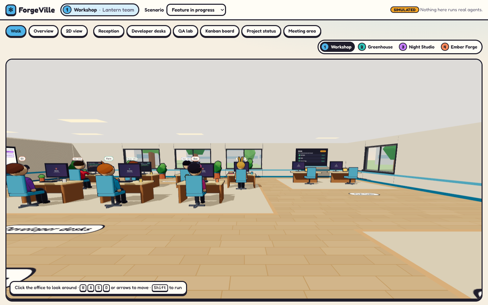
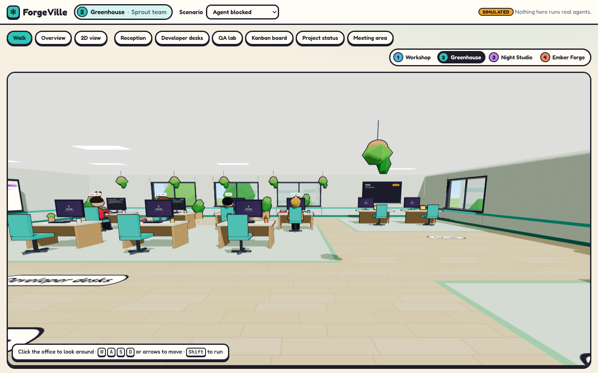
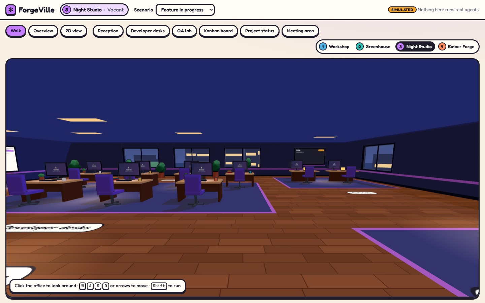
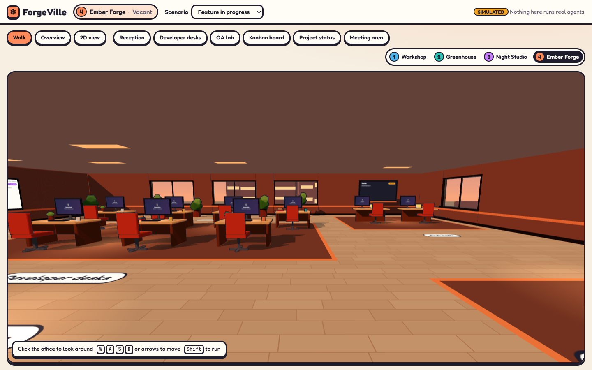

# ForgeVille

A charming, cartoon-style 3D office where AI coding agents work together to build software.

You walk a cel-shaded office building, stop by agent desks to read their terminals, move cards on the Kanban whiteboard, review pull requests in the QA lab, and check mission control. Everything you see comes from one mock workflow, so the 3D office, the 2D view, and the panels always agree.



## Milestone limits

This is **milestone 0: a simulated prototype**. It runs entirely in your browser.

- No real coding agents run. Claude Code, Codex, Pi, and OpenCode appear only as labels.
- No GitHub reads or writes. Pull requests, checks, and merges are mock data.
- No backend, database, or paid external service. State lives in memory and resets when you reload.
- Every simulated surface carries a visible **Simulated** label.

See [Limitations](#limitations) for the full list.

## Setup

You need Node.js 20.19 or newer.

```sh
npm install
npm run dev
```

Open the URL Vite prints (normally http://localhost:5173).

### Commands

| Command | What it does |
| --- | --- |
| `npm run dev` | Start the Vite dev server with hot reload |
| `npm run build` | Type-check and build a production bundle into `dist/` |
| `npm run preview` | Serve the production build locally |
| `npm run typecheck` | Run TypeScript in strict mode without emitting files |
| `npm run lint` | Run ESLint with zero warnings allowed |
| `npm test` | Run the Vitest unit and component tests once |
| `npm run test:watch` | Run Vitest in watch mode |
| `npm run test:e2e` | Run the Playwright end-to-end tests (starts the dev server for you) |

Playwright needs a Chromium build the first time:

```sh
npx playwright install chromium
npm run test:e2e
```

[`e2e/README.md`](e2e/README.md) explains how to reuse a Chromium that is already installed and what the walkthrough test covers.

### URL options

| Query | Effect |
| --- | --- |
| `?scenario=<id>` | Start on a demo scenario: `feature-in-progress` (default), `review-and-qa-pass`, `qa-failure`, `agent-blocked`, `successful-merge`. An unknown id falls back to the default and says so. |
| `?webgl=off` | Skip the 3D office and use the 2D view, as if the browser had no WebGL |
| `?debug=perf` | Dev server only: a frame-time readout (ms, fps, draw calls, triangles, tier) over the office |

## Controls

| Input | Action |
| --- | --- |
| Click the office | Lock the mouse and look around |
| Mouse (while locked) | Look |
| <kbd>W</kbd> <kbd>A</kbd> <kbd>S</kbd> <kbd>D</kbd> or arrow keys | Walk |
| <kbd>Shift</kbd> (held) | Run |
| <kbd>E</kbd> | Open the desk, board, screen, or elevator you are facing (a hint names it) |
| Click an object (mouse unlocked) | Open that desk, board, screen, or elevator |
| <kbd>Esc</kbd> | First press releases the mouse; the next press closes the open panel |
| **Walk** / **Overview** / **2D view** buttons | Switch between first-person, a top-down overview, and the 2D alternative |
| Zone buttons (Reception, Developer desks, QA lab, Kanban board, Project status, Meeting area) | Travel to that zone in 3D, or select it in the 2D view |
| Floor picker (**1 Workshop** to **4 Ember Forge**) | Ride straight to that floor |
| **Follow the clock** | Let the sky follow the scenario time (night, dawn, noon, golden hour, dusk) instead of each floor's own mood. Off by default |
| **Graphics** menu | Pick Low, Medium (default), High, or Auto. Low drops outlines on small props, halves the shadow map, and renders at 1× pixel density; High adds a soft glow to screens and lit lamps. Auto starts on High and drops one tier, with a notice, when the office stays under 45 fps for 3 seconds. Kept in this browser |
| Elevator (walk up to it and press <kbd>E</kbd>, or click it) | Lists every floor with its theme and occupant, and takes you there |
| **Scenario** menu | Load one of the five demo scenarios across every view |

Keys are ignored while focus is in a text field or a panel that captures keys, such as the terminal. Movement keys follow physical position, so AZERTY layouts get the same layout. With reduced motion enabled in your OS, looping animation, errands, and confetti stop, and state and sky changes are instant.

## Building

The office is a building of four floors. They share one floor plan and differ by theme. Projects move in from the ground floor up, one per floor.

| Floor | Theme | Look | Today |
| --- | --- | --- | --- |
| 1 | Workshop | Honey oak and morning sun | The Lantern team works here (seven agents) |
| 2 | Greenhouse | Birch, sage, and far too many plants | The Sprout team works here (four agents) |
| 3 | Night Studio | Walnut, indigo, and warm desk lamps | Vacant |
| 4 | Ember Forge | Copper, concrete, and a golden-hour sky | Vacant |

Floors 1 and 2 are occupied. Each floor shows only its own team: the desks, characters, whiteboard, QA screen, status display, and 2D lists all read that floor's slice of the one snapshot. Mission control shows the current floor next to the building totals, and the elevator lists each team's active agents and blocked tasks. Opening the desk of someone on another floor (from the mission control feed, say) offers "Go to floor N" instead.

Floors 3 and 4 are vacant for now. You can ride there and walk around; the furniture is in place but nobody works there, and only the elevator is interactive.

The office is lived in, but none of it is workflow. Idle agents get up now and then for a coffee at the cart, a stretch, or a chat at the meeting table, and always come back to their desk; each errand is seeded from the agent and the scenario clock, so a scenario always plays the same way. Working agents type in bursts, blocked agents sigh, and a merge throws confetti over the author's desk. Sunlit windows throw soft patches of light on the floor. All of this reads presence and never changes it.

| | |
| --- | --- |
|  |  |
| Floor 1 · Workshop | Floor 2 · Greenhouse |
|  |  |
| Floor 3 · Night Studio | Floor 4 · Ember Forge |

## Demo scenarios

Each scenario is deterministic data plus a fixed event log, not random timers.

| Scenario | What happens |
| --- | --- |
| Feature in progress | Ada, Bruno, and Chen are mid-task on Lantern. Dara has work ready. |
| Review and QA pass | Fern approved pull request #2 and every required check passed. It can be merged. |
| QA failure | The browser check failed on pull request #2, so LN-2 went back to Ada. |
| Agent blocked | Chen is blocked on LN-4 until the LN-3 sync API lands, and asked for help. |
| Successful merge | Pull request #2 passed the merge policy and merged. LN-2 is done. |

## Architecture

[`specs/architecture.md`](specs/architecture.md) is the binding reference. In short:

- **The store is the single source of truth.** `src/store/` holds the workflow snapshot (projects, agents, tasks, sessions, pull requests, test runs, reviews, events). The 3D office, the 2D view, and every panel read from it. Nothing in the scene owns workflow state.
- **Rules live in the domain.** `src/domain/` defines task transitions, agent presence, the merge policy, and mission-control metrics as pure functions. A merge button calls the policy; it cannot bypass it.
- **The mock sits behind a port.** `src/services/ports.ts` defines `WorkflowPort`; `src/services/mock/` implements it with the five scenarios. A guard test fails the build if the mock reaches for the network or processes.
- **Presentation is separate.** `src/world/` draws the building with React Three Fiber; `src/features/` holds the panels; `src/ui/` holds tokens and floor themes. Small presentation stores track the view, floor, and open panel, never workflow data.

```text
src/
  app/        composition, providers, scenario bootstrap
  domain/     types, transitions, policies, metrics
  services/   WorkflowPort, the mock service, the effect guard
  store/      workflow store plus navigation and interaction stores
  world/      canvas, building, characters, in-world screens
  features/   desks, terminal, board, QA and pull requests, mission control, navigation
  ui/         tokens, floor themes, fonts
specs/        product brief, architecture, design, roadmap, epics, stories
e2e/          Playwright tests
```

## Limitations

Everything that looks like engineering work is simulated:

- **Agents** are scripted characters bound to mock sessions. No agent runtime is launched.
- **Terminals** replay fixed output. Nothing is typed into a real shell.
- **Checks** (unit tests, build, browser tests) are mock results in the scenario data.
- **Screenshots** in the pull-request panel are labelled placeholders, not captures.
- **Usage** (tokens and cost on each desk) is a mock estimate.
- **Merges** change mock state only, and only when the mock policy allows them. No branch is merged anywhere.

The app makes no requests to GitHub or agent vendors, and the end-to-end walkthrough fails if any request leaves the dev server. Not supported in this milestone: deploying the prototype, saving state between reloads, and more than one project.

## Roadmap

[`specs/roadmap.md`](specs/roadmap.md) is the build order. Milestone 0 (epics E01 to E09) is done. Milestone 0.5 ([E10](specs/epics/E10-living-building.md), the living building) adds multi-project floors, time of day, and quality tiers on top of it without changing workflow rules.

### Recommended next milestone

Connect **one real coding-agent runtime to an isolated local workspace**, keeping the office on `WorkflowPort` with a new adapter in place of the mock. That work is only specified as a boundary in [E11](specs/epics/E11-future-boundary.md) and is **not implemented**. It stays blocked until its entry criteria are met.

## Contributing

1. Read [`specs/product-brief.md`](specs/product-brief.md) and [`specs/architecture.md`](specs/architecture.md).
2. Pick the next `todo` story in [`specs/roadmap.md`](specs/roadmap.md) and implement only that story, with its tests.
3. Before pushing, run `npm run typecheck`, `npm run lint`, `npm test`, and `npm run test:e2e`.
4. Set the story's status to `done` in the story file and the roadmap.

## License

[MIT](LICENSE)
